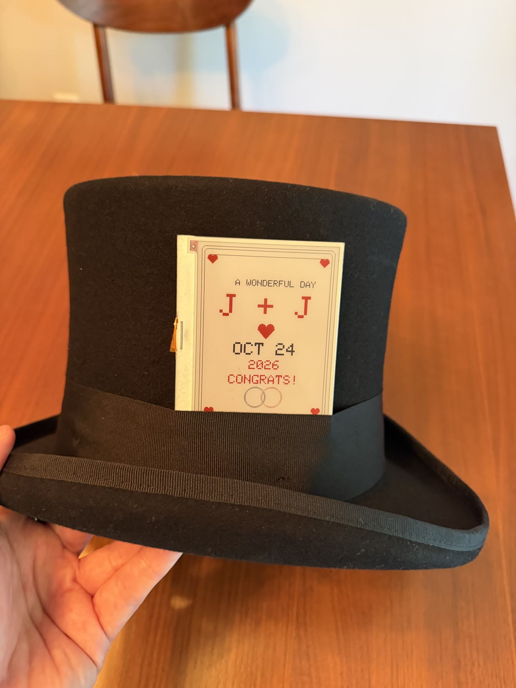
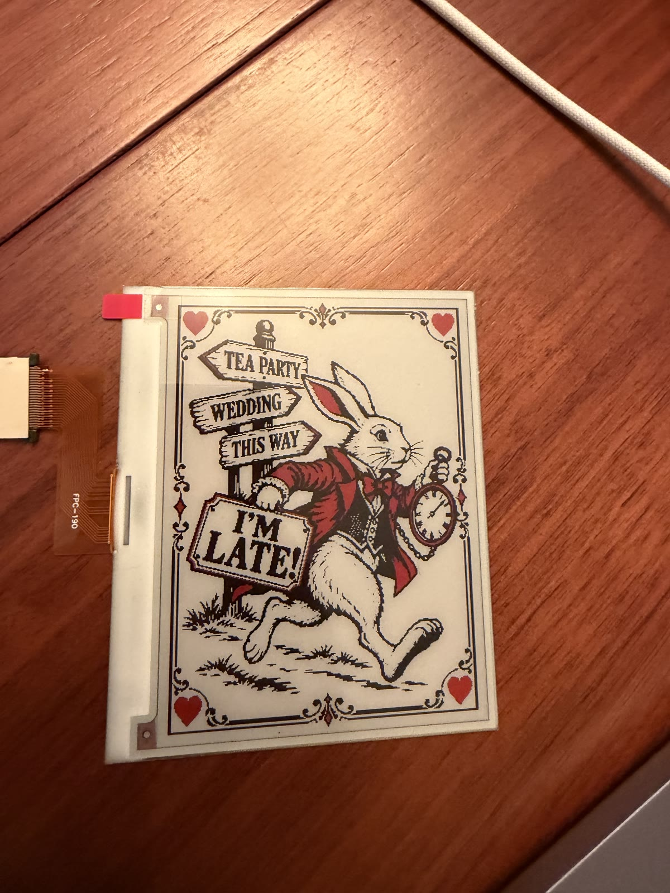
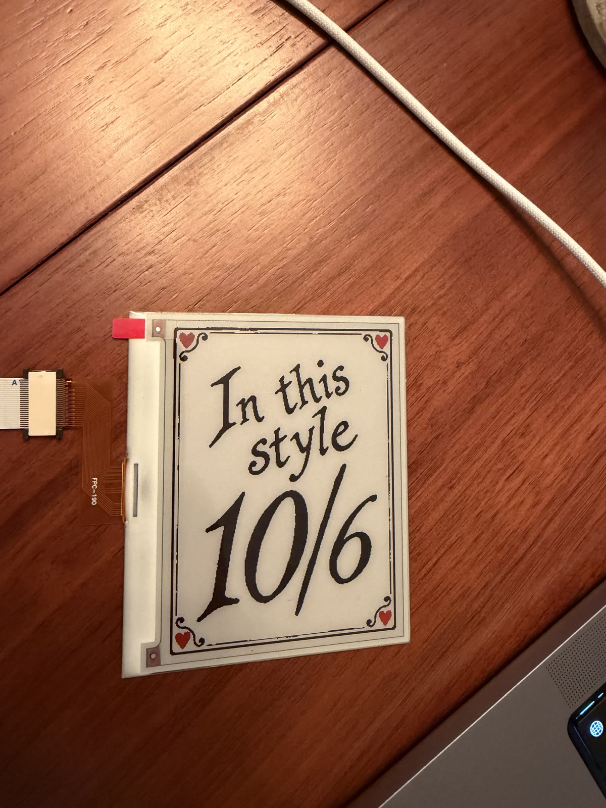
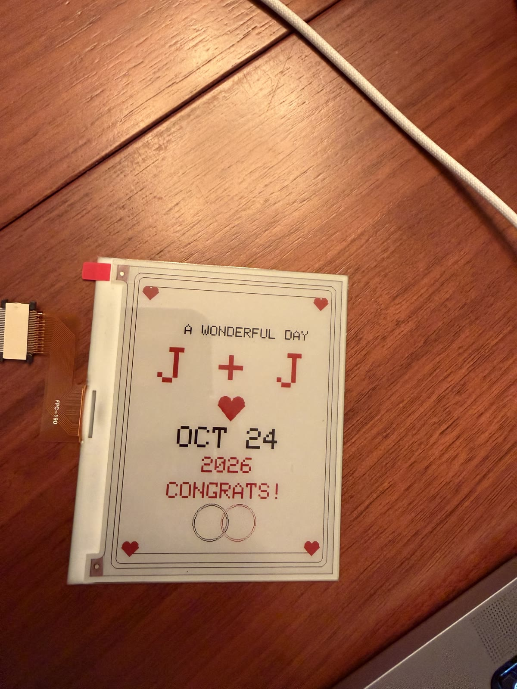
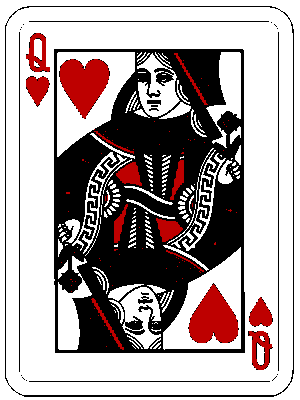

# Mad Hatter Card 🎩

An electronic playing card built into a Mad Hatter costume using a 4.2-inch tri-color e-paper display, an Adafruit Feather RP2040 ThinkInk controller, and a rechargeable LiPo battery.

The goal is to create a convincing playing card attached to the outside of a Mad Hatter top hat, with all the electronics hidden inside the crown.

This was originally created for a Halloween-themed wedding.

## Preview



*The electronic playing card mounted on the Mad Hatter hat.*

### Display gallery

| White Rabbit card | Mad Hatter 10/6 card |
| --- | --- |
|  |  |

| Wedding card | Queen of Hearts card |
| --- | --- |
|  |  |

## Overview

This project uses an e-paper display to recreate the appearance of a traditional playing card, inspired by the **10/6** card tucked into the Mad Hatter's hat.

Unlike a conventional LCD or OLED screen, e-paper looks more like printed paper and retains its image even when power is removed. This makes it particularly well suited for a costume accessory.

### Features

- 4.2-inch e-paper display
- RP2040-based microcontroller
- Rechargeable LiPo battery
- Low-power display technology
- Hidden electronics and wiring
- Customizable card artwork
- No external power connection required during use

## Hardware

| Component | Purpose |
|---|---|
| [Adafruit 4.2-inch 300×400 tri-color e-paper display (#6382)](https://www.adafruit.com/product/6382) | SSD1683 display panel; draws black, white, and red |
| [Adafruit Feather RP2040 ThinkInk (#5727)](https://www.adafruit.com/product/5727) | RP2040 controller and dedicated 24-pin e-paper connector |
| [500 mAh LiPo battery (#1578)](https://www.adafruit.com/product/1578) | Portable power |
| [24-pin FPC ribbon extension (#4230)](https://www.adafruit.com/product/4230) and [extender (#4524)](https://www.adafruit.com/product/4524) | Extends the display ribbon between the panel and controller |
| USB cable | Programming and charging, where supported |
| Mad Hatter top hat | Houses the electronics |

The display is mounted on the outside of the hat. Its ribbon cable runs behind the hatband into the crown, where the controller and battery are concealed.

## How It Works

1. Card artwork is converted into a format supported by the e-paper display.
2. The artwork is stored in the microcontroller's firmware.
3. When powered on, the microcontroller initializes the display and draws the card.
4. The e-paper panel retains the image without continuous refreshes.

Because the display is bistable, it can continue showing the card even after power is disconnected.

## Arduino Setup

The firmware is C++ for the Arduino IDE.

1. In Arduino IDE, open **Preferences/Settings** and add this to **Additional Boards Manager URLs**:

   ```text
   https://github.com/earlephilhower/arduino-pico/releases/download/global/package_rp2040_index.json
   ```

2. Open **Tools → Board → Boards Manager**, search for `RP2040`, and install **Raspberry Pi Pico/RP2040/RP2350 by Earle F Philhower, III**.
3. Open **Tools → Board → Raspberry Pi RP2040 Boards** and select **Adafruit Feather RP2040 ThinkInk**.
4. In **Library Manager**, install **Adafruit EPD**. When Arduino asks to install dependencies, choose **Install all**. This installs the required **Adafruit GFX Library** and **Adafruit BusIO** dependencies.
5. Connect the display's 24-pin ribbon through the extension and extender to the ThinkInk board, with each ribbon fully seated and its locking tab closed. Connect the board over a USB **data** cable.
6. Select the board's USB port under **Tools → Port** and upload [mad_hatter_card_test.ino](mad_hatter_card_test/mad_hatter_card_test.ino).

For the finished portrait cards, upload [mad_hatter_cards.ino](mad_hatter_cards/mad_hatter_cards.ino) instead. It uses the red protective-film pull tab as the card's top edge and changes every five minutes between a `10/6` card, a `J + J` wedding card for October 24, 2026, a traditional Queen of Hearts card, and an `I'M LATE!` White Rabbit card.

To inspect a single card without waiting for the rotation, set `PREVIEW_CARD` near the top of the sketch, upload, and wait for the full refresh:

| Value | Card |
|---:|---|
| `0` | 10/6 Mad Hatter |
| `1` | J + J wedding |
| `2` | Traditional Queen of Hearts |
| `3` | White Rabbit / "I'M LATE!" |
| `-1` | Normal five-minute rotation |

Do not rapidly upload different preview values: tri-color e-paper should have at least three minutes between full refreshes. Set it back to `-1` before the event.

The board profile supplies the display's dedicated DC, CS, BUSY, RESET, and secondary SPI pins. Do not substitute generic GPIO pin numbers in the test sketch.

### If upload does not find a port

Hold **BOOT**, press and release **RESET**, then release **BOOT** after the `RPI-RP2` USB drive appears. Click Upload again. A serial port may not appear while the board is in this bootloader mode; that is expected.

### Display test result

The test first clears the panel to white, then draws a bordered test pattern with black and red regions. E-paper updates take several seconds and visibly flicker during a full refresh. The image remains visible after power is removed; that is normal.

## Assembly

The basic assembly process is:

1. Connect the e-paper display to the ThinkInk controller using its ribbon cable, extension, and extender.
2. Connect the battery using the appropriate power connector.
3. Upload the firmware over USB.
4. Verify that the card artwork renders correctly.
5. Mount the display to the hat.
6. Conceal the controller, battery, and wiring inside the crown.

**Important:** Verify the display pinout, ribbon orientation, battery polarity, and controller compatibility before applying power.

## Design Considerations

**Appearance:** The display should resemble an ordinary paper playing card rather than an electronic screen.

**Thickness:** The controller and battery are positioned inside the hat to minimize visible bulk.

**Power:** E-paper consumes most of its energy during screen refreshes, making it useful for battery-powered wearables.

**Mounting:** The display should be removable without permanently damaging the hat or stressing the ribbon cable.

## Future Improvements?

- Multiple selectable playing card designs
- Randomized card artwork
- Button-triggered display changes
- Wireless image updates over Wi-Fi or Bluetooth
- Deep sleep for improved battery life

## License

Personal hobby project. License to be determined.
